# Start here

MCP Server connects an AI assistant, such as Claude, to your Magento Open Source or Adobe Commerce store. You ask
the assistant a question in your own words, for example which products changed this week, and it looks the answer
up in your store. You decide what the assistant may see, and whether it may change anything.

This guide is for store owners and the people who run the store in the Magento admin. It needs no programming.
Installing the module is a developer's task, described in the Developer Guide that comes with it.

Before you start, you need:

- **The module, installed.** If **Stores** > **Settings** has no **MCP Server** entry, ask your administrator for
  access to it, or your developer to install the module.
- **An admin account that may change the configuration, create integrations and open the MCP Server page.** The
  Administrators role has all of this. *Give a colleague access to the MCP Server page* lists the permissions one by
  one.
- **Claude Desktop** on your computer. Cursor and VS Code work too (see *Connect Cursor or VS Code*).

| You want to | Read |
|--------------------------------------------|----------------------------|
| Connect Claude for the first time | *Getting started* |
| Do one particular thing, such as letting the assistant change data | *How-to guides* |
| Understand why the assistant may or may not do something | *How it works* |
| Look up a screen or a setting | *Screens and settings* |
| Fix something that does not work | *Troubleshooting and FAQ* |

Table: Where to go

# Getting started

In this chapter you connect Claude Desktop to your store and ask it your first question. Claude will be able to read
your products and nothing else. It takes about ten minutes.

## Turn on the server

::: admin-path
Stores > Settings > Configuration > MCP Server > MCP Server
:::

::: steps
1. Go to **Stores** > **Settings** > **Configuration**.
2. In the list on the left, click **MCP Server**, then **MCP Server** below it.
3. Expand **General**.
4. Next to **Enable MCP Server**, clear **Use system value**, then select **Yes**.
5. Leave **Read-only Mode** at **Yes**. While it is on, the assistant can read but not change anything.
6. Click **Save Config**.
:::

The message *You saved the configuration.* appears.

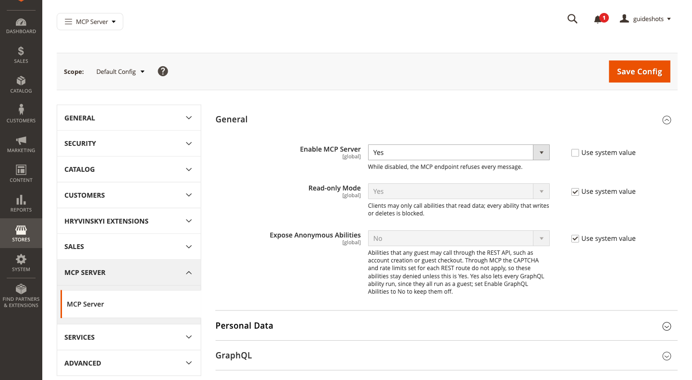

> [!NOTE]
> If the top of the page then says *One or more of the Cache Types are invalidated*, refresh the cache as described
> in *Refresh the cache after a change*.

## Let the store accept integration keys

Claude signs in to your store with the key of an integration. Magento refuses such keys until this setting is on.
You change it once.

::: admin-path
Stores > Settings > Configuration > Services > OAuth
:::

::: steps
1. Go to **Stores** > **Settings** > **Configuration**.
2. In the list on the left, click **Services**, then **OAuth**.
3. Expand **Consumer Settings**.
4. In **Allow OAuth Access Tokens to be used as standalone Bearer tokens**, select **Yes**.
5. Click **Save Config**.
:::

## Create an integration for Claude

An integration is a key to your store with its own permissions. Claude signs in with it and can do only what its
permissions allow. Here it gets one permission to connect and one to read products.

::: admin-path
System > Extensions > Integrations
:::

::: steps
1. Go to **System** > **Extensions** > **Integrations** and click **Add New Integration**.
2. In **Name**, enter `Claude`.
3. In **Your Password**, enter the password you use to sign in to the admin.
4. In the list on the left, click **API**. **Resource Access** already shows **Custom**; leave it.
5. In **Resources**, expand **Stores** > **MCP Server** and select **Use the MCP endpoint**.
6. Expand **Catalog** > **Inventory** and select **Products**.
7. Click the arrow next to **Save**, then **Save & Activate**.
8. Magento lists the access you chose. Click **Allow**.
9. Magento shows the integration's keys. Copy the **Access Token**: you paste it into Claude Desktop in the next
   step. Then click **Done**.
:::

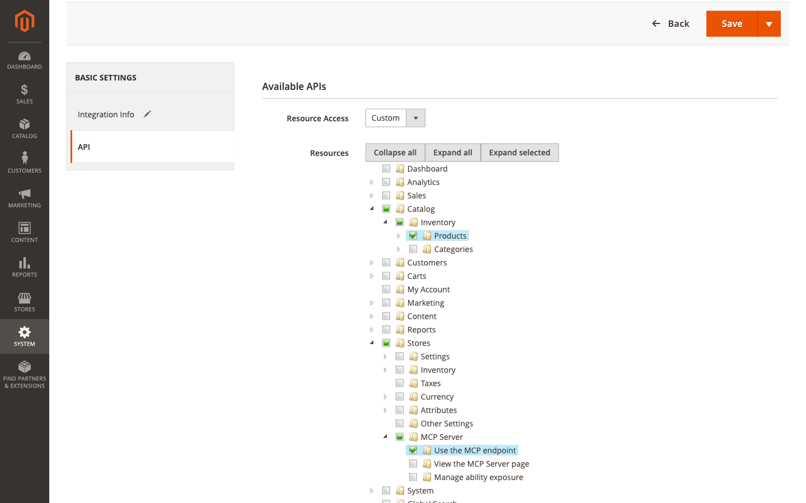

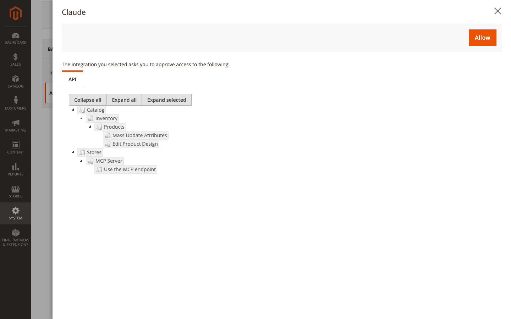

> [!IMPORTANT]
> The access token is a key to your store. Keep it like a password: do not send it by e-mail or paste it into a
> chat.

> [!TIP]
> You can copy the access token again later. In **System** > **Extensions** > **Integrations**, click the pencil
> icon in the **Edit** column of the integration: **Integration Details** shows the **Access Token**.

## Connect Claude Desktop

::: admin-path
Stores > Settings > MCP Server
:::

::: steps
1. Go to **Stores** > **Settings** > **MCP Server**.
2. In the **Install** card, click **Download for Claude Desktop (.mcpb)**.
3. Open the downloaded file with Claude Desktop and install the extension.
4. When Claude Desktop asks for the extension's settings, leave **Store endpoint** as it is, and paste the access
   token you copied into **Access token**.
:::

Claude Desktop keeps the token in your computer's keychain, the place where your computer keeps passwords.

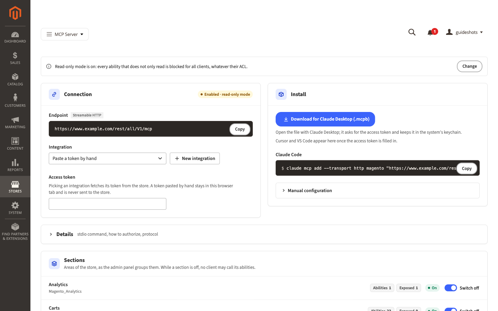

## Ask your first question

In Claude Desktop, start a new chat and ask:

> Show me the five products in my store that were changed most recently.

Claude looks through the actions your store offers, finds the one that lists products, runs it, and answers with the
names and SKUs of five products. Your assistant is connected.

If Claude says that the store refused it, find its answer in *Troubleshooting and FAQ*.

# How-to guides

## Refresh the cache after a change

Magento sometimes asks you to refresh its cache after you save a setting: the top of the page says *One or more of
the Cache Types are invalidated*.

::: admin-path
System > Tools > Cache Management
:::

::: steps
1. Go to **System** > **Tools** > **Cache Management**.
2. Select the row of every cache type whose **Status** reads **INVALIDATED**.
3. In **Actions**, select **Refresh**.
4. Click **Submit**.
:::

Magento confirms how many cache types it refreshed, for example *2 cache type(s) refreshed.*

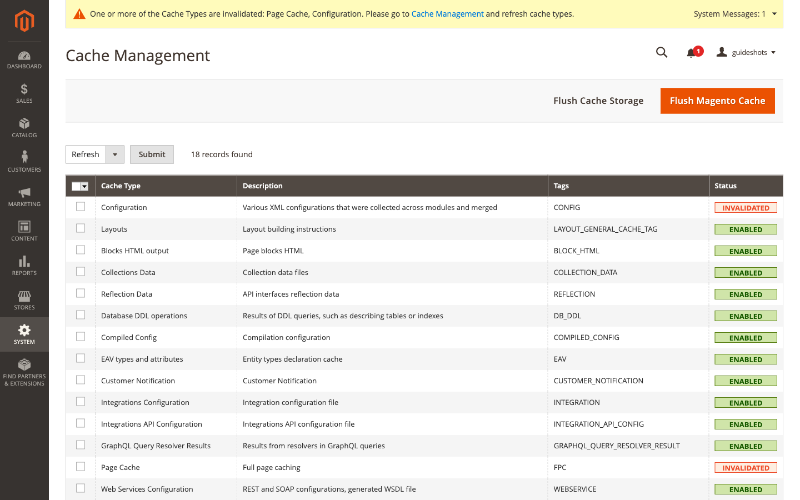

## Give each person or app its own integration

Create one integration for each person or app that connects, named after them. You can then take access away from
one without touching the others, and give each only the permissions it needs.

::: steps
1. Create the integration as in *Create an integration for Claude*, with the person's or the app's name.
2. In **Resources**, select **Use the MCP endpoint** and only the areas this person or app needs (see *Choose what
   the assistant may read*).
:::

## Connect Cursor or VS Code

::: admin-path
Stores > Settings > MCP Server
:::

::: steps
1. Go to **Stores** > **Settings** > **MCP Server**.
2. In the **Connection** card, in **Integration**, select the integration for this app. Its access token fills the
   **Access token** field, shown as dots. If the integration is not in the list, paste its access token into
   **Access token** instead.
3. In the **Install** card, click **Add to Cursor** or **Install in VS Code**.
4. Confirm the installation in the app that opens.
:::

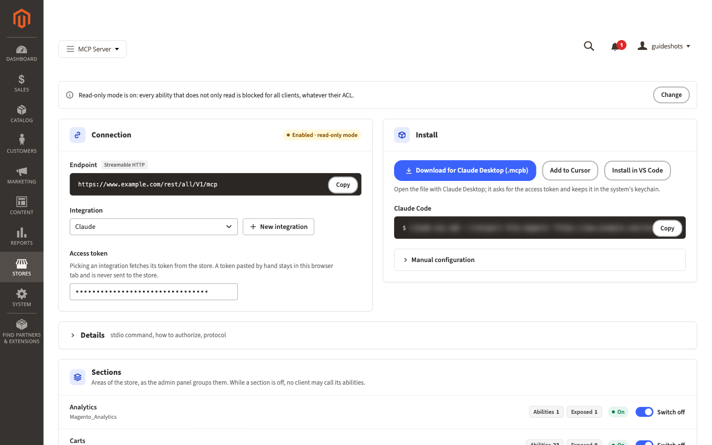

> [!NOTE]
> **Add to Cursor** and **Install in VS Code** appear only once **Access token** holds a token. Cursor and VS Code
> keep the token in their own settings file, readable by anyone who can open that file on the computer.

The **Integration** list appears only if your admin account may manage integrations. A token you paste by hand stays
in your browser tab and is never sent to the store.

## Choose what the assistant may read

The integration's permissions decide what the assistant may do: what the integration may not do, the assistant
cannot do either.

::: admin-path
System > Extensions > Integrations
:::

::: steps
1. Go to **System** > **Extensions** > **Integrations**.
2. Click the pencil icon in the **Edit** column of the integration.
3. In **Your Password**, enter your admin password.
4. In the list on the left, click **API**.
5. Select the areas from the table below, and clear the ones the assistant should not use.
6. Click **Save**.
:::

The change applies to the assistant's next action.

| To let the assistant read | Select in **Resources** |
|----------------------------|----------------------------------------------------|
| Products | **Catalog** > **Inventory** > **Products** |
| Categories | **Catalog** > **Inventory** > **Categories** |
| Orders | **Sales** > **Operations** > **Orders** > **Actions** > **View** |
| Customers | **Customers** |
| CMS pages | **Content** > **Elements** > **Pages** |
| CMS blocks | **Content** > **Elements** > **Blocks** |

Table: Common permissions

Keep **Use the MCP endpoint** selected: without it, the assistant cannot connect at all.

## Let the assistant change data

Read-only mode is on after installation, so the assistant can only read. Turn it off when you want the assistant to
change things, for example to update product descriptions.

> [!WARNING]
> With read-only mode off, the assistant can change and delete anything its integration's permissions allow. Give
> the integration only the areas it should change, and consider *Make the assistant ask you first* for actions that
> change data.

::: admin-path
Stores > Settings > Configuration > MCP Server > MCP Server
:::

::: steps
1. Go to **Stores** > **Settings** > **Configuration**, then **MCP Server** > **MCP Server** in the list on the left.
2. Expand **General**.
3. Next to **Read-only Mode**, clear **Use system value**, then select **No**.
4. Click **Save Config**.
:::

To turn read-only mode back on, select **Yes** again, or select **Use system value**, and click **Save Config**. The
**Change** button in the read-only notice at the top of the MCP Server page opens these settings too.

## Switch off a whole area of the store

The **Sections** card lists the areas of your store, as the admin menu groups them: Catalog, Sales, Customers and so
on. While an area is switched off, no assistant may use any of its actions, whatever its permissions.

::: steps
1. Go to **Stores** > **Settings** > **MCP Server**.
2. In the **Sections** card, find the area and click **Switch off**.
:::

The message *The section Customers is switched off: no client may call its abilities.* appears, the area shows
**Off**, and its **Exposed** count drops to 0. To undo, click **Switch on**.

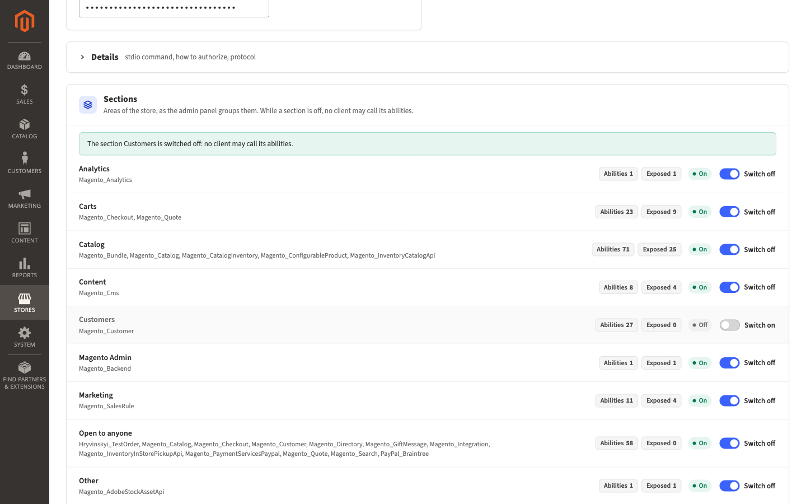

## Stop the assistant from using one action

Put the action on the deny-list. Find it first in the **Ability catalog** at the bottom of the MCP Server page.

::: steps
1. Go to **Stores** > **Settings** > **MCP Server** and scroll to **Ability catalog**.
2. In **Search by keyword**, enter part of the action's name, for example `customer_repository`, and press Enter.
3. Select the row of the action.
4. In **Actions**, select **Add to deny-list**.
5. In the *Add to deny-list?* dialog, click **OK**.
:::

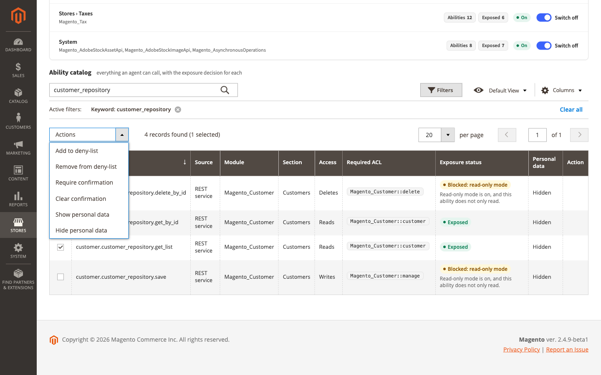

The action's **Exposure status** now reads **Denied: deny-list**. To undo, click **Remove from deny-list** in the
**Action** column of its row, and click **OK** in the *Remove from deny-list?* dialog.

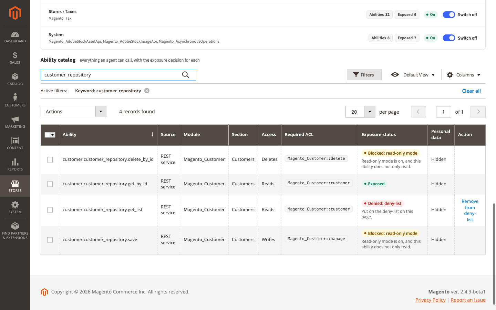

## Make the assistant ask you first

Mark an action as needing confirmation. The assistant then asks you in the chat before each use, and goes ahead only
after you agree.

::: steps
1. Go to **Stores** > **Settings** > **MCP Server** and scroll to **Ability catalog**.
2. Search for the action and select its row.
3. In **Actions**, select **Require confirmation**. It applies at once.
:::

The action's **Exposure status** now reads **Needs confirmation**. To undo, select its row and choose **Clear
confirmation** in **Actions**.

> [!CAUTION]
> Confirmation relies on the assistant asking you, and well-behaved assistants such as Claude do. It is not a lock:
> for anything that must never happen without you, use the deny-list or read-only mode instead.

## Let the assistant see customer details for one action

Names, e-mail addresses, phone numbers, addresses and similar details are hidden from the assistant: they reach it
as *\[personal data\]*. You can show them for chosen actions, for example when the assistant should write to customers
about their orders.

> [!IMPORTANT]
> What the assistant receives goes to the company that runs the AI (for Claude, Anthropic). Show personal data only
> when your data processing agreement with that company covers it.

::: steps
1. Go to **Stores** > **Settings** > **MCP Server** and scroll to **Ability catalog**.
2. Search for the action and select its row.
3. In **Actions**, select **Show personal data**.
4. In the *Show personal data?* dialog, click **OK**.
:::

The action's **Personal data** column now reads **Shown**, and a notice at the top of the page reminds you that a
data processing agreement must cover it. To undo, select the row and choose **Hide personal data**.

## Give a colleague access to the MCP Server page

::: admin-path
System > Permissions > User Roles
:::

What a colleague may do in the admin depends on the role of their admin account. Add the MCP Server permissions to
that role.

::: steps
1. Go to **System** > **Permissions** > **User Roles** and click your colleague's role.
2. Click **Role Resources**. If **Resource Access** reads **All**, the role already has every permission, and you
   are done.
3. Under **Stores** > **MCP Server**, select **View the MCP Server page**, and **Manage ability exposure** if your
   colleague should change what assistants may do.
4. Under **Stores** > **Settings** > **Configuration**, select **MCP Server Settings** if your colleague should
   change the settings.
5. Under **System** > **System Extensions**, select **System Integrations** if your colleague should create
   integrations and pick them on the MCP Server page.
6. Click **Role Info**, and in **Your Password**, enter your admin password.
7. Click **Save Role**.
:::

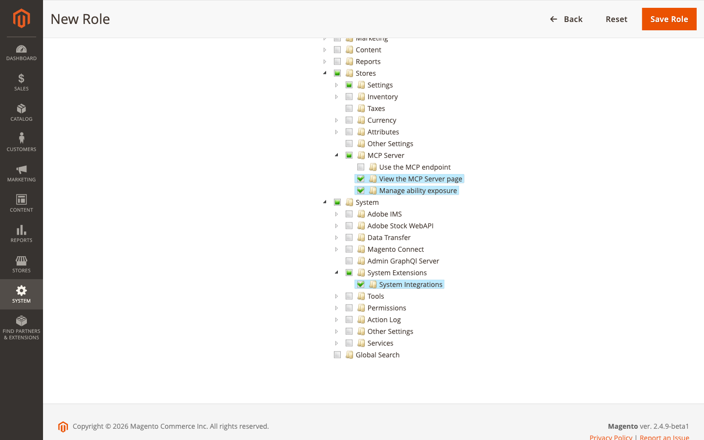

Every admin account with this role gets the permissions. An account has one role only: moving your colleague to
another role takes away the permissions of their current one.

**Use the MCP endpoint** is for integrations: your colleague does not need it to work on the page.

## Take access away

Delete the integration. The assistant that uses it is refused from its next action on, and its access token stops
working for good.

::: admin-path
System > Extensions > Integrations
:::

::: steps
1. Go to **System** > **Extensions** > **Integrations**.
2. In the row of the integration, click the trash icon in the **Delete** column.
3. In the dialog, click **OK**.
:::

The message *The integration 'Claude' has been deleted.* appears, with your integration's name.

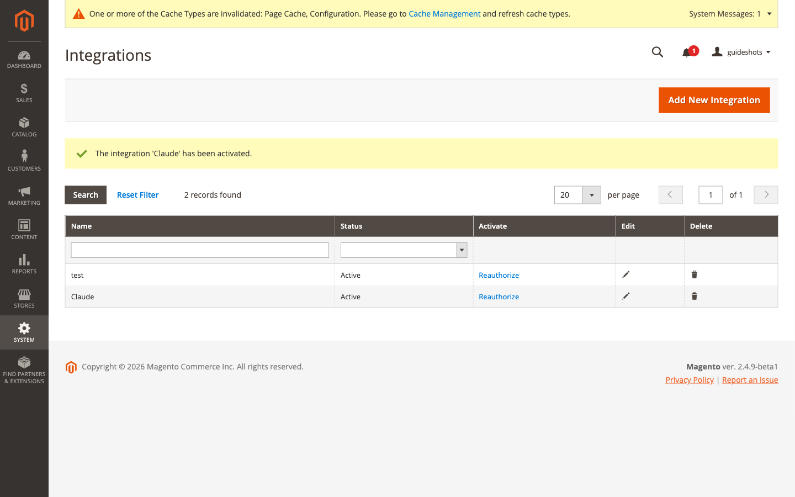

## Give an assistant a new access token

Replace the token when someone else may have seen it. The integration keeps its permissions, and the old token stops
working.

::: admin-path
System > Extensions > Integrations
:::

::: steps
1. Go to **System** > **Extensions** > **Integrations**.
2. In the row of the integration, click **Reauthorize**.
3. In the dialog, click **Reauthorize**.
4. Copy the new **Access Token**, then click **Done**.
:::

Then give the new token to every app that used the old one:

| App | What to do |
|----------------------|------------------------------------------------------------|
| Claude Desktop | Open the store's extension in Claude Desktop's settings, and paste the new token into **Access token**. |
| Cursor, VS Code | On the MCP Server page, select the integration in **Integration**, click **Add to Cursor** or **Install in VS Code** again, and confirm in the app. |

Table: Where the new token goes

## Find out what the assistant can do

The **Ability catalog** at the bottom of the MCP Server page lists every action an assistant may ask your store to
run, and says for each whether it may.

::: steps
1. Go to **Stores** > **Settings** > **MCP Server** and scroll to **Ability catalog**.
2. In **Search by keyword**, enter a word from the action's name, for example `product`, and press Enter. Or click
   **Filters** to narrow the list by section, access or exposure.
3. Read **Exposure status**: **Exposed** means an assistant may use the action, as far as its integration's
   permissions allow.
:::

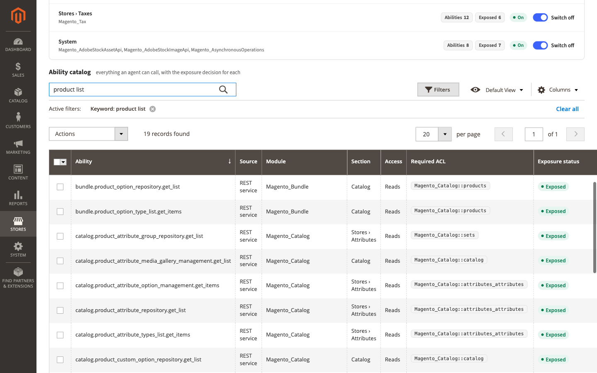

*Screens and settings* explains every column.

## Turn the server off

::: admin-path
Stores > Settings > Configuration > MCP Server > MCP Server
:::

::: steps
1. Go to **Stores** > **Settings** > **Configuration**, then **MCP Server** > **MCP Server** in the list on the left.
2. Expand **General**.
3. In **Enable MCP Server**, select **No**.
4. Click **Save Config**.
:::

Every assistant is refused until you turn the server on again, and is told *The MCP server is disabled.* Your
integrations and the choices on the MCP Server page stay as they are.

# How it works

## What the assistant does in your store

The assistant does not receive a copy of your store. It asks your store to run an action, such as *list products*,
and receives the answer. The actions are the same operations Magento already offers to other programs, for example
to a warehouse system. MCP Server calls them *abilities* and gives each a name, such as
`catalog.product_repository.get_list` for listing products. The Ability catalog lists them all.

## Who the assistant acts as

The assistant signs in with an integration's access token and acts as that integration. Magento checks the
integration's permissions before every action, as it does for any program that connects to the store. What the
integration may not do, the assistant cannot do either.

## The rules on top of permissions

The MCP Server page adds rules that apply to every assistant, whatever its integration may do. When several apply to
an action, the strictest wins.

| Rule | Effect |
|--------------------------|----------------------------------------------------------|
| Server turned off | Every assistant is refused. |
| Built-in deny-list | Some actions are never allowed: anything about integrations and access tokens, passwords, two-factor authentication, and logging in as a customer. You cannot change this. |
| Deny-list | Actions you put on it are refused. |
| Section switched off | Every action of that area is refused. |
| Open to anyone | Actions any visitor of your store may use without signing in, such as creating a customer account, are refused while **Expose Anonymous Abilities** is **No**. |
| Read-only mode | Actions that change or delete data are refused. |
| Confirmation | The assistant asks you before the action runs. |

Table: Rules, from the strictest

**Expose Anonymous Abilities** stays **No** for a reason. In the storefront, those actions are protected against
abuse, for example by CAPTCHA and by limits on repeated requests. Through the assistant, these protections do not
apply. Change it only on your developer's advice.

## Personal data

What an action returns goes to the assistant, and from there to the company that runs the AI, often outside the
European Union. That is why personal details are hidden after installation: names, e-mail addresses, phone numbers,
street addresses, dates of birth, tax and VAT numbers and similar fields reach the assistant as *\[personal data\]*. The
assistant is told so, and does not ask for them.

Text written freely, such as order comments, is not hidden. If your order comments hold personal details, ask your
developer to add the comment fields to **Personal Data Fields**.

# Screens and settings

## MCP Server settings

::: admin-path
Stores > Settings > Configuration > MCP Server > MCP Server
:::

Every setting here applies to the whole store, which the admin shows as *[global]* under the setting's name.

| Setting | What it does | After installation |
|-------------------------|-----------------------------------------------------------|------------|
| **Enable MCP Server** | While **No**, every assistant is refused. | **No** |
| **Read-only Mode** | While **Yes**, assistants may only use actions that read. | **Yes** |
| **Expose Anonymous Abilities** | Whether assistants may use actions open to any visitor of the store (see *How it works*). **Yes** also lets every GraphQL lookup run (see the **GraphQL** settings below); set **Enable GraphQL Abilities** to **No** to keep those off. | **No** |
| **Hide Personal Data** | While **Yes**, personal details reach assistants as *\[personal data\]*. **No** sends them to every action. | **Yes** |
| **Personal Data Fields** | The kinds of details to hide, one per line. Shown only while **Hide Personal Data** is **Yes**. Change it only with your developer. | E-mail, names, phone, address, date of birth and similar |

Table: General and Personal Data

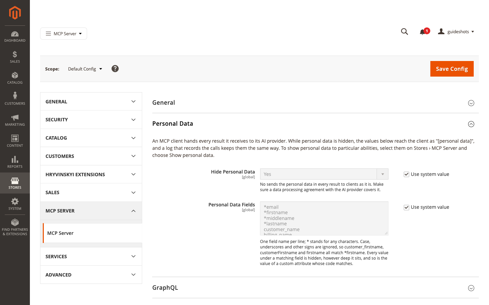

GraphQL is the interface your storefront and apps use to look up products, categories and pages. The **GraphQL**
group decides whether assistants may use it too.

| Setting | What it does | After installation |
|-------------------------|-----------------------------------------------------------|------------|
| **Enable GraphQL Abilities** | While **Yes**, the lookups of this interface are actions too. They run as a visitor who is not signed in, so they stay refused while **Expose Anonymous Abilities** is **No**. | **Yes** |
| **Expose GraphQL Mutations** | While **Yes**, the interface's actions that change data are offered as well. Read-only mode blocks them. | **No** |
| **GraphQL Endpoint URL** | The address of the interface. Leave it empty unless your developer gives you one: empty means your store's own address. | Empty |
| **Store View** | The store view the lookups run in. | **Default Store View** |

Table: GraphQL

## The MCP Server page

::: admin-path
Stores > Settings > MCP Server
:::

**Notices** at the top of the page: while the server is turned off, one notice says so, with an **Enable in
configuration** button. While it is on, notices tell you when read-only mode is on and when some action shows
personal data, each with a **Change** button. The buttons open the MCP Server settings, and appear only if your
account may change them.

**Connection** card

| Item | What it is |
|----------------------|------------------------------------------------------------|
| Status badge | **Enabled · read-only mode**, **Enabled** or **Disabled**. |
| **Endpoint** | Your store's address for assistants, with a **Copy** button. |
| **Integration** | Pick an integration to fill its access token into **Access token**. **Paste a token by hand** clears the pick. Shown only if your account may manage integrations. |
| **New integration** | Opens Magento's form for a new integration in a new tab. |
| **Access token** | The token the install buttons use, shown as dots. A token you paste here never leaves your browser tab. |
| OAuth warning | *Integration tokens are not accepted as Bearer tokens…*, while the store refuses integration keys. Its **Open the OAuth settings** button opens the setting (see *Let the store accept integration keys*). |

Table: The Connection card

**Install** card

| Item | What it is |
|----------------------|------------------------------------------------------------|
| **Download for Claude Desktop (.mcpb)** | The file that connects Claude Desktop to this store. |
| **Add to Cursor**, **Install in VS Code** | Add the store to these apps. They appear once **Access token** holds a token. |
| **Claude Code**, **Manual configuration** | For developers; see the Developer Guide. |

Table: The Install card

**Details** (folded) holds technical information for developers.

**Sections** card: each area of the store with the modules in it, **Abilities** (how many actions it has),
**Exposed** (how many an assistant may use now), **On** or **Off**, and the **Switch off** or **Switch on** button.
Two areas are not part of the admin menu: **Open to anyone** holds actions any visitor may use, and **Other** holds
actions that fit no area.

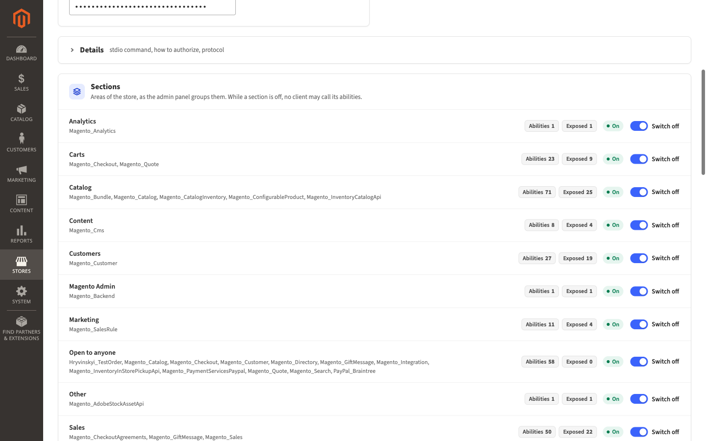

**Ability catalog**

| Column | What it shows |
|----------------------|------------------------------------------------------------|
| **Ability** | The action's name. |
| **Source** | Where the action comes from, for example **REST service**: one of the store's own operations. |
| **Module** | The part of Magento that provides it. |
| **Section** | The area of the store it belongs to. |
| **Access** | **Reads**, **Writes** or **Deletes**. |
| **Required ACL** | The permission the integration needs, as Magento names it internally. The **Section** column tells you where to find it in the **Resources** tree. |
| **Exposure status** | Whether an assistant may use it, and if not, why. |
| **Personal data** | **Hidden** or **Shown**. |
| **Action** | A change you can make to this one row, such as **Remove from deny-list**. |

Table: Columns of the Ability catalog

| Exposure status | Meaning |
|--------------------------------|-----------------------------------------------------------|
| **Exposed** | Assistants may use it, within their integration's permissions. |
| **Needs confirmation** | The assistant asks you before each use. |
| **Blocked: read-only mode** | It changes data, and read-only mode is on. |
| **Denied: deny-list** | You put it on the deny-list. |
| **Denied: built-in deny-list** | It is never allowed. |
| **Denied: section off** | Its area is switched off. |
| **Denied: open to anyone** | It is open to any visitor, and **Expose Anonymous Abilities** is **No**. |

Table: Exposure statuses

| In **Actions** | Effect |
|--------------------------------|-----------------------------------------------------------|
| **Add to deny-list** | Assistants may not use the selected actions. Asks you to confirm. |
| **Remove from deny-list** | Takes them off the deny-list. |
| **Require confirmation** | The assistant asks you before each use. |
| **Clear confirmation** | Removes that. |
| **Show personal data** | The selected actions send personal details. Asks you to confirm. |
| **Hide personal data** | They hide personal details again. |

Table: Actions of the Ability catalog

An action that is always denied, or blocked by read-only mode, offers no change: its status does not depend on this
page.

## Permissions

The module adds these entries to the **Resources** tree of user roles and integrations.

| Entry | Lets you or an integration |
|------------------------------------------------------|----------------------------------------------------|
| **Stores** > **MCP Server** > **Use the MCP endpoint** | Connect an assistant. Every integration for an assistant needs it. |
| **Stores** > **MCP Server** > **View the MCP Server page** | Open the MCP Server page and download the Claude Desktop file. |
| **Stores** > **MCP Server** > **Manage ability exposure** | Change sections, the deny-list, confirmations and personal data on the page. |
| **Stores** > **Settings** > **Configuration** > **MCP Server Settings** | Change the MCP Server settings. |

Table: Permissions of MCP Server

# Troubleshooting and FAQ

## Claude says the MCP server is disabled

The server is turned off. Turn it on as in *Turn on the server*. If Claude still says so after you saved, refresh
the cache (*Refresh the cache after a change*).

## Claude cannot connect to the store at all

Check, in this order:

1. **Stores** > **Settings** > **Configuration** > **Services** > **OAuth** > **Consumer Settings**: **Allow OAuth
   Access Tokens to be used as standalone Bearer tokens** must be **Yes**. The MCP Server page warns you while it is
   not.
2. **System** > **Extensions** > **Integrations**: the integration is still there, and its **Status** is
   **Active**.
3. The integration's **API** tab has **Use the MCP endpoint** selected.
4. The token you pasted into Claude Desktop is complete. Copy it again from **Integration Details** if in doubt.

## The MCP Server page says integration tokens are not accepted

The page says *Integration tokens are not accepted as Bearer tokens, so the store refuses every MCP client that
sends one.* Click **Open the OAuth settings** in the warning, and set **Allow OAuth Access Tokens to be used as
standalone Bearer tokens** to **Yes**, as in *Let the store accept integration keys*.

## Picking an integration shows a note instead of filling the token

The note says why the integration cannot be used. Its **Edit integration** button opens the integration in a new
tab. The fixes in **System** > **Extensions** > **Integrations**:

| Note | What to do |
|----------------------------------------|-------------------------------------------------------|
| *Not activated yet.* | Click **Activate** in its row, then **Allow**, then **Done**. |
| *Its settings changed.* | Click **Activate** in its row, then **Reauthorize**. The integration gets a new access token: give it to every app that used the old one (see *Give an assistant a new access token*). |
| *Its API resources leave out "Use the MCP endpoint".* | Edit the integration, enter your admin password in **Your Password**, select **Use the MCP endpoint** in its **API** tab, and click **Save**. |
| *It has no usable access token.* | Give it a new token as in *Give an assistant a new access token*. |
| *The token could not be fetched.* | Reload the page and pick again, or paste the token by hand. If it keeps happening, ask your developer. |

Table: Notes of the Integration list

After a fix, reload the MCP Server page and pick the integration again.

## A button or the MCP Server menu entry is missing

Each part of the page needs a permission in the role of your admin account:

| Missing | Permission your role needs |
|----------------------------------------|-------------------------------------------------------|
| **MCP Server** in **Stores** > **Settings** | **Stores** > **MCP Server** > **View the MCP Server page** |
| The **Actions** menu and the **Action** column of the Ability catalog, **Switch off** and **Switch on** | **Stores** > **MCP Server** > **Manage ability exposure** |
| **Enable in configuration** and **Change** in the notices | **Stores** > **Settings** > **Configuration** > **MCP Server Settings** |
| **Integration** and **New integration** in the **Connection** card | **System** > **System Extensions** > **System Integrations** |
| **Open the OAuth settings** | **Stores** > **Settings** > **Configuration** > **OAuth Configuration** |

Table: Permissions behind the page

Ask an administrator to add the permission to your role, as in *Give a colleague access to the MCP Server page*.

## Claude says read-only mode is on

Claude reports something like *Read-only mode is on, and the ability "catalog.product_repository.save" changes data.*
This is expected while read-only mode is on. If the assistant should change data, see *Let the assistant change
data*.

## Claude says its role lacks a permission

Claude reports something like *The ability "sales.order_repository.get_list" needs ACL resources your role lacks:
Magento_Sales::actions_view.* The integration does not have the permission this action needs. Add it as in *Choose
what the assistant may read*; the table there covers the common cases, and the action's **Section** in the Ability
catalog tells you which part of the **Resources** tree to look in.

## Claude says an action is on the deny-list

Claude reports *The ability "…" is on the deny-list of this store.* Someone put it on the deny-list. To allow it
again, see *Stop the assistant from using one action*. If the Ability catalog shows **Denied: built-in deny-list**,
the action is never allowed.

## Claude says an action is not exposed (section_off)

Claude reports *The ability "…" is not exposed to MCP clients (section_off).* Its area is switched off in the
**Sections** card. Click **Switch on** to allow it.

## Claude says an action is open to anonymous callers

Claude reports *The ability "…" is open to anonymous callers, and this store does not expose such abilities.* This is
expected; *How it works* explains why.

## Names and e-mail addresses arrive as \[personal data\]

This is expected while personal data is hidden. To show it for particular actions, see *Let the assistant see
customer details for one action*.

## Claude asks me to confirm before it does something

The action is marked **Needs confirmation**. Answer Claude in the chat. To stop the question, see *Make the assistant
ask you first*.

## Add to Cursor and Install in VS Code do not appear

They appear only once **Access token** holds a token. Pick the integration in **Integration**, or paste its token.

## Download for Claude Desktop shows an error instead of a file

The MCP Server page shows a message about the store's address instead of the file, for example *The store's endpoint
… uses plain http to a host other than this computer, so the extension would send the access token unencrypted and
refuses to start.* The extension sends the access token only to an address that starts with `https://`, unless the
store runs on your own computer. Ask your developer to give the store a secure address; the message tells them what
to change.

## Questions

**Does the assistant see everything in my store?**
No. It sees only what its integration's permissions allow, minus switched-off areas and denied actions, and personal
details stay hidden unless you show them.

**Can the assistant change prices or delete products?**
Only after you turn read-only mode off, and only if its integration has the permission to change products.

**Does the access token expire?**
No. It works until you delete the integration or give it a new token (see *Take access away* and *Give an assistant
a new access token*).

**Where does Claude Desktop keep the token?**
In your computer's keychain.

**Does turning the server off delete my integrations or settings?**
No. They stay as they are and apply again when you turn the server on.

**Where do I get more help?**
Ask your developer, or open an issue at <https://github.com/hryvinskyi/magento2-mcp-server/issues>.

# Glossary

| Term | Meaning |
|-----------------------|-------------------------------------------------------------------|
| AI assistant | A program you talk to in your own words, such as Claude, that can use your store's actions. |
| MCP | Model Context Protocol: the common language AI assistants use to connect to other programs. MCP Server makes your store speak it. |
| Ability | One action the assistant can ask your store to run, such as listing products. |
| Integration | A key to your store with its own permissions, made in **System** > **Extensions** > **Integrations**. |
| Access token | The secret text of an integration's key. Whoever holds it acts as the integration. |
| Endpoint | Your store's address for assistants, shown on the MCP Server page. |
| Read-only mode | A setting that lets assistants read but not change anything. |
| Section | An area of the store, such as Catalog or Sales, that you can switch off for assistants. |
| Deny-list | The list of actions no assistant may use. |
| Confirmation | A mark that makes the assistant ask you before an action. |
| Personal data | Details that identify a person, such as a name or an e-mail address. |
| GraphQL | The interface your storefront and apps use to look up products, categories and pages. |
| Permission | A right in the **Resources** tree of a role or an integration, such as **Products**. Magento calls them ACL resources. |
| Cache | Stored copies Magento keeps to be fast. After some changes, Magento asks you to refresh them. |
| Data processing agreement | A contract with a company that handles personal data for you, required under the GDPR. |

Table: Glossary

# Appendix A — Document history {.unnumbered}

| Version | Date | Changes |
|--------|------------|----------------------------------------------------------|
| 1.0 | 2026-11-09 | First version, for MCP Server 1.4.2. |

Table: Document history

# Open questions {.unnumbered}

Not yet tried on a computer with these apps. Remove each item once it is checked.

- *Connect Claude Desktop*, steps 3 and 4: how Claude Desktop installs the file and asks for its settings. Written
  from the MCP Server page's own hint and the extension's two settings, **Store endpoint** and **Access token**.
- *Connect Cursor or VS Code*, step 4: what Cursor and VS Code ask before they add the store.
- *Give an assistant a new access token*: where Claude Desktop keeps an installed extension's settings, and whether
  **Add to Cursor** and **Install in VS Code** replace the store's earlier entry or add a second one.
